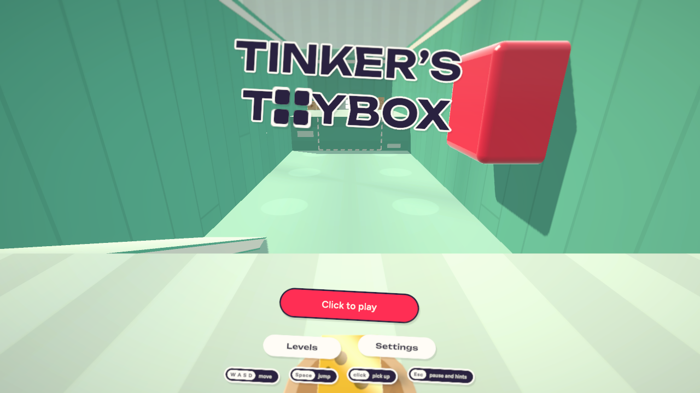
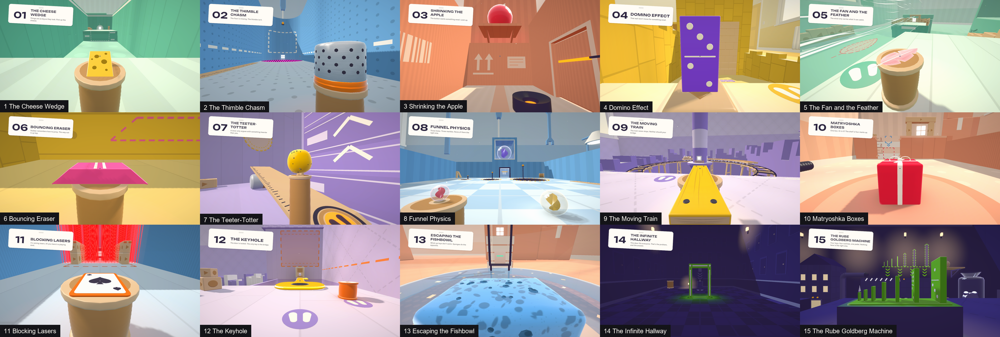

# Tinker's Toybox

A first-person puzzle platformer where you play a tiny action figure in an oversized playroom.
Your only tool is **forced perspective**: pick up a toy, and it keeps its on-screen size while it lands on
whatever is behind it. Pick up a block in front of your face, look across the room, let go — and it
arrives as a building-sized monolith.

**Play it:** https://sramireddy2.github.io/tinkerstoybox/

It runs in a current desktop browser (Chrome, Edge or Firefox with WebGL 2) and needs a keyboard and a
mouse. Fifteen levels and an ending; progress and settings are kept in the browser.



Built with **Unity 6** (URP, WebGL). No imported art or audio: meshes, textures, shaders and sounds are
all generated in code (the fonts are the one exception, see [Credits](#credits)).

## How the mechanic works

```
NewScale = OldScale × (NewDistance / OldDistance)
```

While you hold a toy it is continuously projected along your line of sight to the farthest free
spot, scaled so that it covers exactly the same part of your screen. Letting go hands it back to the
physics engine at that size — with mass to match. Far away means big, close by means small, and how far
away you were when you picked it up decides how big it can get.

## The fifteen levels



| Level | What it is about |
|---|---|
| 1 The Cheese Wedge | Far away means big: a crumb of plastic cheese, let go across the toy chest, lands as a hillside. |
| 2 The Thimble Chasm | A size has to fit: a silver thimble the size of a water tower corks the hole in the floor. |
| 3 Shrinking the Apple | Near means small: an apple the size of a boulder comes off the shelf small enough for a button. |
| 4 Domino Effect | Size is weight: one domino, made as tall as a house, brings down a wall of blocks. |
| 5 The Fan and the Feather | Size is area: a feather wide enough to catch a desk fan's wind is the raft across the canyon. |
| 6 Bouncing Eraser | Size is bounce: an eraser as big as a bus is the trampoline to the top of the cabinet. |
| 7 The Teeter-Totter | A lever: stand on one end of a ruler while a pebble grown into a boulder lands on the other. |
| 8 Funnel Physics | Exact sizes, three times: three marbles, three funnels, none of them the right size. |
| 9 The Moving Train | Timing: a plank let go onto a train that never stops is the bridge to the lighthouse. |
| 10 Matryoshka Boxes | Several toys from one: a gift box turns out to be three, and three boxes are a stair. |
| 11 Blocking Lasers | A held toy is not in the world: a playing card is a roof against the laser rain once you let go. |
| 12 The Keyhole | One toy, two jobs: the only key to the door is also the bridge to it. |
| 13 Escaping the Fishbowl | Size is capacity: a sponge carries a fishbowl's water through a change of size. |
| 14 The Infinite Hallway | The toy resizes you: a loose door frame makes whoever walks through it its own size. |
| 15 The Rube Goldberg Machine | Everything at once: four toys, four outlines, one pedal, judged by running the machine. |

Every level has three hints (on the pause card, one at a time; the third is the recipe), and a level
you have finished stays in the catalogue (**Levels**) with your best time.

## Controls

Keyboard and mouse. There are no touch controls: the game needs a computer. (A phone or tablet that
opens the page is told so before the game is downloaded.)

| Input | Action |
|---|---|
| `W` `A` `S` `D` or the arrow keys | Move |
| Mouse | Look (click the game to capture the mouse; where the browser refuses, hold the right button) |
| Click / `E` | Pick up / let go |
| `Q` / mouse wheel | Turn the held toy (15° steps) |
| `F` | Flip the held toy a quarter turn (a toy that has to stay upright does not flip) |
| `Space` | Jump |
| `Shift` | Sprint |
| `R` | Restart the level: hold it for half a second (a tap only says so). On the pause card a tap restarts |
| `Esc` | Pause (frees the mouse); `Esc` again or **Resume** goes on |

The game names its keys itself: four of them on the title screen, all of them beside the pause card, and
as small key caps in the corner of the screen until you have used each a few times. The pause card also
has the hints, the settings (quality, lens blur, mouse speed, invert look, field of view, volumes, reduce
motion, high-visibility toys) and the level's name and goal.

## Address parameters

| Add to the address | What it does |
|---|---|
| `?level=3` | Starts on that level instead of the title screen. A level's name works too (`?level=cheese-wedge`); `0`, `98` and `99` are the sandbox, the gadget gallery and the toy showroom |
| `&autoplay=1` | The built-in bot plays: it solves the level and goes on through the campaign to the ending. Nothing it plays counts as progress |
| `&plain=1` | The plain debug look: Unity's standard materials, flat lighting and a debug read-out instead of the game's HUD and menus |
| `&debug=1` | The debug keys (below) |

`&debug=1` turns the debug keys on (they are always on in the editor's Play Mode, and with
`&autoplay=1`): `[` and `]` load the previous / next level, and `P` hands the level to the built-in bot
from its start (`P` again takes over). Nothing the bot has played counts as progress. Without the
parameter these keys do nothing.

## Opening the project

You need **Unity 6000.6.4f1** with the **WebGL Build Support** module, installed through Unity Hub in its
default folder (the command-line tools look for it under `C:\Program Files\Unity\Hub\Editor\6000.6.4f1`).
The packages come with the project: URP 17.6, Input System 1.20, UGUI 2.6 with TextMesh Pro, Unity Test
Framework 1.8.

Open the repository root in Unity (Unity Hub → Add → project from disk) and press Play: the game starts
on its title screen whichever scene is open. Keep the project **outside OneDrive / Dropbox** — synced
folders make Unity's file operations fail in odd ways.

The **Toybox** menu in the editor has the rest:

| Menu item | What it does |
|---|---|
| Play Game | Enters Play Mode on the title screen |
| Level Launcher | A window listing every level, each with **Play** and **Watch bot** (the built-in solver plays it) |
| Build WebGL | Makes the browser build into `Build/WebGL` in the project folder |
| Capture Shots | Renders one still of the sandbox (level 0) to `tools/out/shots/level00-t00.png` without entering Play Mode, and leaves an empty untitled scene open. Other levels, times and the UI are options of the command line (below) |
| Run Project Setup | Creates whatever is missing of the scene, materials, fonts and render assets, and puts project settings back to what the code says. Assets that exist are not made again |

Everything is built from C#: levels, toys and environments are code, not hand-placed scene content, so
the Main scene holds a single `Bootstrap` object and the Hierarchy fills in when the game runs. The code
is under `Assets/Toybox`: `Runtime` (`Engine`, `Gadgets` and `Levels` are the simulation, `Toys` the toy
catalog, `Art` the palette and the generated meshes and materials; `Render`, `UI`, `Audio` and `Platform`
present the game and run it), `Editor` (setup steps, the picture tool, the build), `Shaders`, and
`Tests/EditMode`.

| Document | What is in it |
|---|---|
| [docs/ARCHITECTURE.md](docs/ARCHITECTURE.md) | The engine contract: how the simulation, the levels, the presenters and the tools fit together; what is tested and what is knowingly left |
| [docs/LEVEL_AUTHORING.md](docs/LEVEL_AUTHORING.md) | The level author's short reference: a level, the toys, the gadgets, the picture commands |
| [docs/LEVELS.md](docs/LEVELS.md) | The campaign: every level's design, what was built and measured, and its known limits |
| [docs/ART_BIBLE.md](docs/ART_BIBLE.md) | The look and the UI |

## Command-line tooling (Windows PowerShell)

Run these from the repository root. If PowerShell refuses to run scripts, call them as
`powershell -ExecutionPolicy Bypass -File tools\unity.ps1 test`. `unity.ps1` and
`editor-check.ps1` print a short report that ends in `RESULT: OK` or `RESULT: FAILED`.

```powershell
.\tools\unity.ps1 compile
```

Imports and compiles the project in a background headless editor. Do this once on a fresh clone: the
next tool reuses what it leaves behind. The background editor keeps running and serves `compile`,
`test`, `exec` and `playcheck` one call at a time.

```powershell
.\tools\typecheck.ps1
```

Compiles the game's C# with Unity's own compiler in a few seconds, without starting Unity. It needs one
`.\tools\unity.ps1 compile` to have run before.

```powershell
.\tools\unity.ps1 exec -Method Toybox.EditorTools.Shots.Capture -UnityArgs '-toyboxLevel','3','-toyboxTimes','0,2,5','-toyboxUi','hud'
```

Renders stills of a level, played by its bot, into `tools/out/shots`
([docs/LEVEL_AUTHORING.md](docs/LEVEL_AUTHORING.md) lists the options: the tier, the size, an overview
camera, every menu screen).

```powershell
.\tools\unity.ps1 playcheck -UnityArgs '-toyboxUrl','?level=3&autoplay=1'
```

Plays a level in Play Mode in the background editor, with the bot at the controls, and reports whether
it was completed and what was logged on the way.

```powershell
.\tools\editor-check.ps1 -Level 1,2,3
```

Opens the project in the real, windowed Unity editor (on a private copy), enters Play Mode on each
level, lets the bot solve it and closes the editor again: the check that the project opens and plays
the way Unity Hub opens it.

```powershell
python tools/webgl_check.py --levels 1 2 3
```

Checks a WebGL build in a real browser (the Edge or Chrome already installed, through Playwright:
`pip install playwright`). It loads each level with the bot playing and fails on a page that stops
answering, a low frame rate, console errors or silence; `--play` adds a first minute at the keyboard
through real mouse and key events. The build has to be served first; see [Releasing](#releasing).

```powershell
.\tools\unity.ps1 build
```

Makes a WebGL build. It writes to `%USERPROFILE%\.cache\tinkerstoybox\Build\WebGL` (not into the project
folder) and **stops the background editor first**, because a build needs the project to itself for
several minutes. `.\tools\build-clone.ps1` builds from a private copy instead and leaves the background
editor alone, and `.\tools\deploy.ps1` publishes a build; see [Releasing](#releasing).

```powershell
.\tools\unity.ps1 stop
```

Shuts the background editor down (do this before opening the project in the Unity editor yourself).

## Tests

```powershell
.\tools\unity.ps1 test
.\tools\unity.ps1 test -Filter "Level03Tests"
```

Runs the EditMode tests through the background editor: about 2200 tests in six to eight minutes, or
with `-Filter` (a regular expression on the full test name) a part of them. The output ends in
`RESULT: OK` or `RESULT: FAILED`.

- The simulation is stepped manually, so nothing needs Play Mode: each level ships with a test in which
  a scripted bot actually solves it through the same input a player has, and with dozens more for its
  size window, its wrong tries and the lines it says about them.
- `Phase1CampaignTests`, `Phase2CampaignTests` and `Phase3CampaignTests` play the levels as a campaign;
  the last plays the whole game from the title to the ending, by hand-driven menus and by `&autoplay=1`.
- 67 of the tests are explicit probes and picture tours that a run without a filter skips. A filter that
  names their class runs them too (minutes of tables and pictures): filter them out with, for example,
  `-Filter "Level09Tests\.(?!Probe_|Tour_)"`.
- `ReleaseTests` hold this README and the documents under `docs/` to the code: the level list, the
  controls' words, the tools, the links, the fonts' notices.
- Not covered by the suite: the WebGL build itself. That is what `tools/webgl_check.py` and a look at
  the page are for.

## Releasing

The page at https://sramireddy2.github.io/tinkerstoybox/ is the `gh-pages` branch, which holds one
commit: the latest build. A release is four steps, each of which must pass before the next.

```powershell
# 1. The whole suite. Commit what passes: step 2 builds HEAD, not the working folder.
.\tools\unity.ps1 test

# 2. The release build of HEAD, made in a private copy
#    (%USERPROFILE%\.cache\tinkerstoybox\buildclone; the build lands in ...\tinkerstoybox\Build\WebGL).
.\tools\build-clone.ps1 -Committed -Opt RuntimeSpeed

# 3. The build in a real browser: serve it in one window ...
python -m http.server 5180 --directory $env:USERPROFILE\.cache\tinkerstoybox\Build\WebGL
#    ... and check every level, the first one by hand, and the page as a phone sees it, in another
#    (once: pip install playwright).
python tools/webgl_check.py --all --seconds 60 --play --phone

# 4. Publish the build that was checked.
.\tools\deploy.ps1 -SkipBuild
```

- **Pass `-Opt RuntimeSpeed` to `build-clone.ps1` for a release.** Without `-Opt` it builds with
  `BuildTimes` (a faster build of a slower game) unless `-Deploy` is given, which builds with
  `RuntimeSpeed`. `deploy.ps1` without `-SkipBuild` also builds with `RuntimeSpeed`, but in the main
  folder, which stops the background editor and builds work in progress along with what is committed.
- `--seconds 60` gives the bot time for the last level (41 game seconds; the default is 48). The check
  fails on a page that stops answering, a low frame rate, console errors, silence, a mouse that is not
  captured and freed, or a phone that is not told the game needs a computer; it does **not** judge
  whether the bot finished a level. Look at its pictures.
- `webgl_check.py` uses the Edge or Chrome already installed and writes its pictures to
  `tools/out/shots/webgl`. `--base https://sramireddy2.github.io/tinkerstoybox/` runs the same check
  against the published page.
- `deploy.ps1` names the commit it was run from in its message ("Deploy WebGL build of abc1234"), so run
  it from the commit the build was made of.
- What a build cannot be checked for by these tools, and should be looked at by hand after a change to
  the page or the platform code, is listed in [docs/ARCHITECTURE.md](docs/ARCHITECTURE.md) under
  "Testing and verification" and "The final review".

## Credits

Everything in the game is generated in code except its typefaces:

- **Unbounded** Bold — Copyright 2022 The Unbounded Project Authors (https://github.com/googlefonts/unbounded)
- **Figtree** SemiBold — Copyright 2022 The Figtree Project Authors (https://github.com/erikdkennedy/figtree)
- **Liberation Sans**, the fallback face of Unity's TextMesh Pro — Digitized data copyright (c) 2010
  Google Corporation; Copyright (c) 2012 Red Hat, Inc.

All three are licensed under the SIL Open Font License, Version 1.1. The licence texts are beside the
font files (`Assets/Toybox/Fonts/OFL-*.txt`, `Assets/TextMesh Pro/Fonts/LiberationSans - OFL.txt`) and go
out with every build as `licenses.txt` next to the page (the loading screen links to it).

## Licence

No licence has been chosen for the game's own code and content yet. Until a `LICENSE` file says
otherwise, all rights are reserved.
