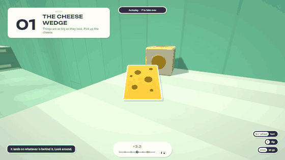
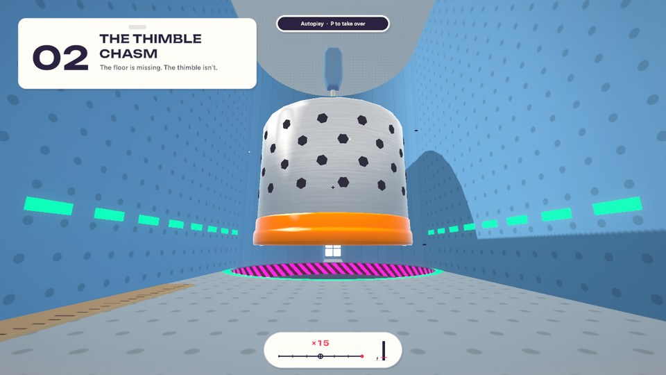
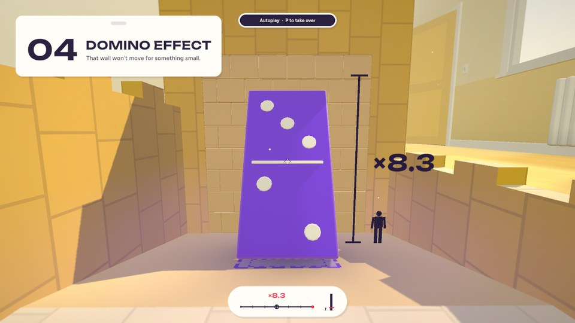
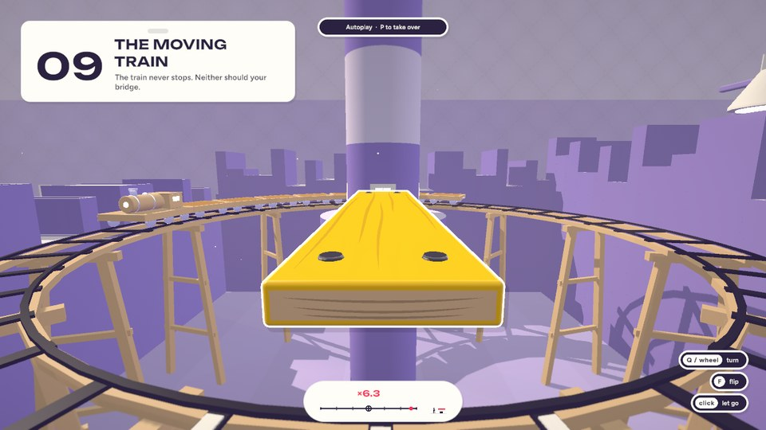
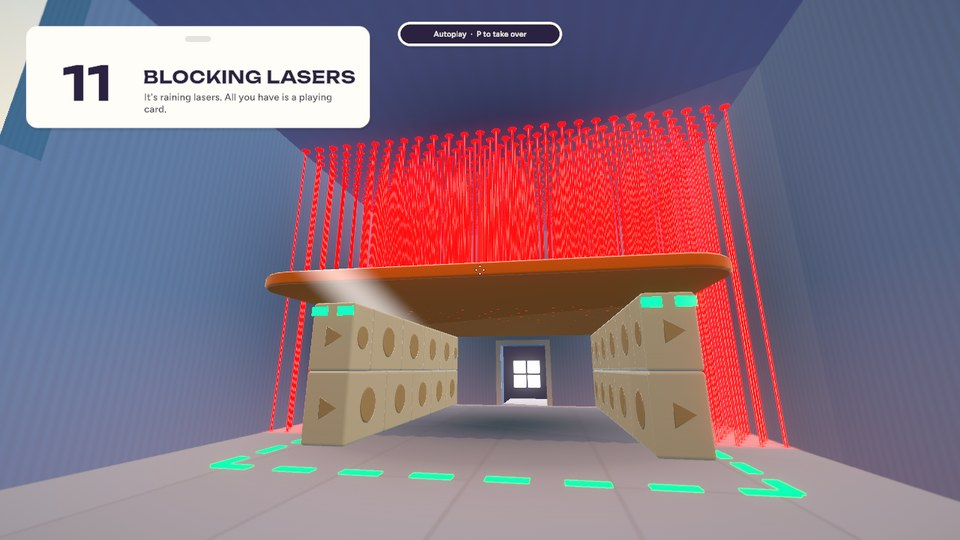
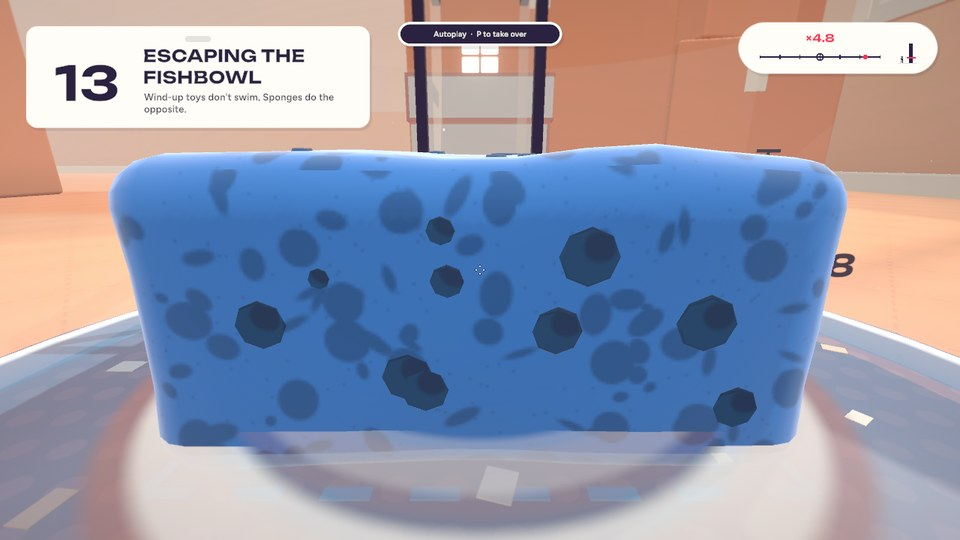
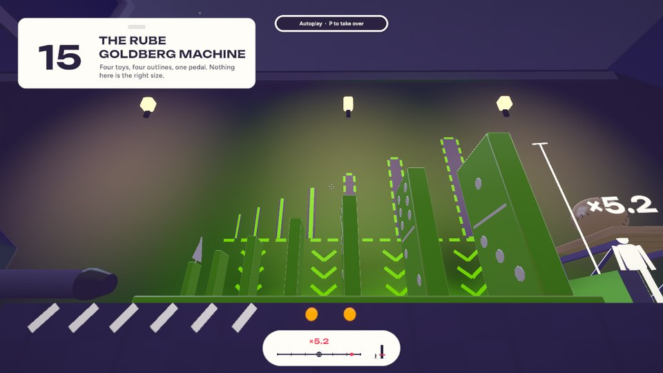

<div align="center">

# Tinker's Toybox

**You're a tiny action figure. The playroom is huge. Your only tool is perspective.**


[](https://sramireddy2.github.io/tinkerstoybox/)


[](LICENSE)



</div>

## The trick

Pick up a toy and it keeps the size it has **on your screen**. So:

- let it go **far away** and it lands **huge** — a crumb of cheese becomes a hillside;
- let it go **at your feet** and it lands **tiny** — an apple the size of a boulder fits on a button.

```
NewScale = OldScale × (NewDistance / OldDistance)
```

That is the whole game: fifteen rooms, one idea, and physics that takes the new size seriously.

**[Play it in your browser](https://sramireddy2.github.io/tinkerstoybox/)** — on a computer, with a
keyboard and a mouse.

## Screenshots

<table>
  <tr>
    <td></td>
    <td></td>
    <td></td>
  </tr>
  <tr>
    <td></td>
    <td></td>
    <td></td>
  </tr>
</table>


## The fifteen levels


| | Level | The idea |
|---|---|---|
| 🧀 | 1 The Cheese Wedge | Far away means big |
| 🧵 | 2 The Thimble Chasm | A size has to fit |
| 🍎 | 3 Shrinking the Apple | Near means small |
| 🧱 | 4 Domino Effect | Bigger is heavier |
| 🪶 | 5 The Fan and the Feather | Bigger catches more wind |
| ✏️ | 6 Bouncing Eraser | Bigger bounces higher |
| 📏 | 7 The Teeter-Totter | A boulder on a lever |
| 🔮 | 8 Funnel Physics | Three exact sizes |
| 🚂 | 9 The Moving Train | A bridge you have to time |
| 🎁 | 10 Matryoshka Boxes | One toy turns out to be three |
| 🃏 | 11 Blocking Lasers | A playing card as a roof |
| 🗝️ | 12 The Keyhole | The key is also the bridge |
| 🧽 | 13 Escaping the Fishbowl | A sponge that carries the water |
| 🚪 | 14 The Infinite Hallway | A door that resizes you |
| ⚙️ | 15 The Rube Goldberg Machine | Everything at once |

Stuck? Every level has three hints on the pause screen.

## Controls

| Key | What it does |
|---|---|
| `W` `A` `S` `D` | Move |
| Mouse | Look |
| Click or `E` | Pick up / let go |
| `Q` or mouse wheel | Turn the held toy (15° steps) |
| `F` | Flip the held toy a quarter turn |
| `Space` | Jump |
| `Shift` | Sprint |
| `R` | Restart: hold it for half a second |
| `Esc` | Pause; `Esc` again or **Resume** goes on |

## Tech stack

| | |
|---|---|
| **Engine** | Unity 6 (6000.6.4f1), C# |
| **Rendering** | URP 17.6 with five hand-written shaders |
| **Physics** | PhysX, stepped by hand at 60 Hz so a run replays exactly |
| **Input and UI** | Input System 1.20, UGUI with TextMesh Pro |
| **Art and audio** | All generated in code: no imported models, images or sound files |
| **Platform** | WebGL 2 and WebAssembly, hosted on GitHub Pages |
| **Tests** | About 2200, including a bot that solves every level |
| **Tooling** | PowerShell, and Python with Playwright for checking the build in a real browser |

## Run it yourself

1. Install **Unity 6000.6.4f1** with the WebGL Build Support module.
2. Open this folder in Unity Hub and press **Play**.
3. Try **Toybox → Level Launcher** in the menu bar: it starts any level, and a built-in bot can play it for you.

To jump to a level in the browser, add `?level=cheese-wedge` (or `?level=3`) to the address, and
`&autoplay=1` to watch the bot solve it.

Building, testing and releasing are in **[docs/DEVELOPMENT.md](docs/DEVELOPMENT.md)**. The design is in
the [architecture](docs/ARCHITECTURE.md), [levels](docs/LEVELS.md), [art bible](docs/ART_BIBLE.md) and
[level authoring](docs/LEVEL_AUTHORING.md) documents.

## Credits

Everything in the game is generated in code except its typefaces:

- **Unbounded** Bold — Copyright 2022 The Unbounded Project Authors (https://github.com/googlefonts/unbounded)
- **Figtree** SemiBold — Copyright 2022 The Figtree Project Authors (https://github.com/erikdkennedy/figtree)
- **Liberation Sans**, the fallback face of Unity's TextMesh Pro — Digitized data copyright (c) 2010
  Google Corporation; Copyright (c) 2012 Red Hat, Inc.

All three are under the SIL Open Font License 1.1; the licence texts sit beside the font files and ship
with every build.

## Licence

[MIT](LICENSE) for the game's code and content. The typefaces keep their own licence.
